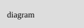

# Architecture

A reference page. The diagram is a notes file the site serves:



As decision 0001 says, the site renders these notes in place.

## Pages

::planning

## Building the docs site

:::steps
1. Install Violet into the docs site:

   ```sh
   make docs-install
   ```

2. Build it, or serve it on port 8009 with `make docs-dev`.
:::
