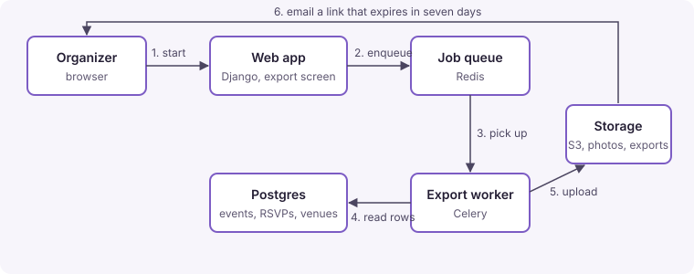

# 0003. Build every export in a background job and email a link

## Context

Decision 0002 streamed exports in the request. A year of photos takes
about seven minutes and the platform stops requests at 30 seconds, so the
zip was cut off. The club app already runs a Celery worker for event
reminder emails.

## Decision

Starting an export creates an `Export` row and queues a job. The job writes
the file, stores it in the private bucket, and emails the organizer a link.
Every export type goes this way, including the quick ones.

## Consequences

- No export is bound by the request limit.
- RSVPs and photos are personal data, so exported files expire and are
  deleted; how soon was left open.
- The screen has to show state (Queued, Building, Ready, Failed, Expired),
  which is :task[7]{topic=export-screen}.
- A slow photo archive could hold up reminder emails in the same queue;
  exports get a queue of their own.
