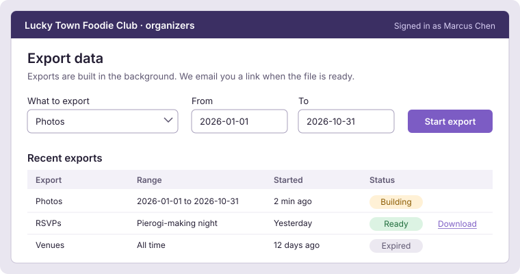

# Export screen brainstorm

How should an organizer get a file out of the club app without a shell?
The [context](context.md) has the numbers: RSVPs and venues are quick,
photos are not.

## Approaches

| | Stream in the request | Background job, email a link | Nightly pre-built files |
|---|---|---|---|
| A year of photos | Times out at 30 seconds | Works, ready in about seven minutes | Works, but up to a day old |
| Tonight's RSVPs | Yes | Yes, a few seconds later by email | No, yesterday's list |
| New moving parts | None | Worker, storage, email | Scheduler, storage |
| Files to clean up | None | Yes, expire after a while | Yes, overwritten nightly |
| Who can start one | Organizers | Organizers | Nobody, it just runs |

## What we tried first

Streaming was the first choice, written down as decision 0002: no new
moving parts, and RSVPs and venues finish well inside the limit. A spike
streaming the photos from 2026 was cut off at 30 seconds. The browser saved
a 640 MB zip that would not open, and showed no error. A broken file the
night before the December social is worse than an error.

## Where we landed

A background job for every export, not only the slow ones, so there is one
path to test and one screen to explain. That is decision 0003. The screen
starts an export, lists recent ones, and the link arrives by email:

In the plan, :task[4] moves the writers into a job and :task[5] stores
the file; :pr[2] ships both.

## Left for later

- Scheduled exports ("every Tuesday, email the welcome host the RSVPs").
  Nobody asked twice.
- Formats beyond CSV and zip: see decision 0001.
